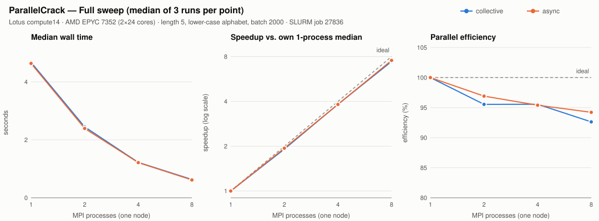

# ParallelCrack — MPI Communication & Performance Benchmark

ParallelCrack is a small, self-contained HPC project — an ongoing undergraduate
project that grew out of COMP 380 coursework — for studying **how the choice
of MPI communication strategy affects the performance of a distributed keyspace
search**. It uses a synthetic password-search workload as a consistent, repeatable
benchmark so that the only thing that changes between experiments is the way the
processes coordinate with each other.

The research question is:

> How do different MPI communication and coordination strategies affect
> distributed keyspace search performance, scalability, and early termination?

This is a **performance-engineering project**, not a tool for attacking real
credentials. Everything it searches is generated locally: the target "password"
is a short string that the program picks itself, and any encrypted file it
recovers is one the program encrypted a moment earlier with a key it generated.
There are no real hashes, no third-party targets, and no user secrets involved.

## Why password search?

A brute-force keyspace search is a convenient benchmark for parallel coordination
because it has three properties that stress the communication layer in interesting
ways:

1. **The work is trivially parallel per candidate** — every candidate can be tested
   independently, so the interesting part is purely the coordination, not the math.
2. **It terminates early** — as soon as one process finds the answer, every other
   process should stop as quickly as possible. How fast that happens depends
   entirely on the communication strategy.
3. **It has a clean, verifiable answer** — we know exactly which candidate is
   correct, so we can check that every strategy returns the same result.

That makes it a good lens for comparing, say, a collective barrier-style
coordination against a message-driven asynchronous one.

## What it does

* Generates candidates **deterministically** from an integer index, so every rank
  agrees on exactly which candidate a given index maps to.
* Distributes the keyspace across MPI ranks with a **static cyclic** scheme.
* Verifies candidates with **SHA-256** (via OpenSSL), the same way in every strategy.
* Stops all ranks as soon as the target is found (**early termination**).
* Optionally recovers a locally generated **AES-256-CBC** encrypted file using the
  password it found, and checks the recovered bytes against the original.
* Reports real, measured metrics (wall time, candidates evaluated, hash rate,
  communication overhead) and can append them to a CSV for plotting.

## Communication strategies (v0.1)

| Strategy       | Key MPI calls                                        | Idea                                                                 |
|----------------|------------------------------------------------------|---------------------------------------------------------------------|
| `collective`   | `MPI_Allreduce`                                       | Every rank searches a batch, then all ranks agree on global state.  |
| `asynchronous` | `MPI_Iprobe`, `MPI_Irecv`, `MPI_Test`, `MPI_Send`, `MPI_Isend`, `MPI_Wait` | Rank 0 coordinates with messages while also doing real search work. |

Both strategies share the **exact same** candidate generator, keyspace, batch
loop, and verification logic. The only difference is how they coordinate. That is
what makes the comparison fair.

## Project layout

```
ParallelCrack/
├── include/            # Public headers (the interfaces between modules)
│   ├── crypto.h        #   hashing + file encryption helpers
│   ├── search.h        #   candidate generation + the shared search workload
│   ├── strategies.h    #   the common strategy interface + result struct
│   └── benchmark.h     #   timing and metrics helpers
├── src/
│   ├── main.c          # CLI parsing + orchestration
│   ├── crypto.c        # OpenSSL SHA-256 and AES-256-CBC
│   ├── search.c        # deterministic candidate generation + batch search
│   ├── benchmark.c     # metrics + CSV output
│   └── strategies/
│       ├── collective.c    # MPI_Allreduce strategy
│       └── asynchronous.c  # message-driven strategy
├── tests/              # correctness tests (compile + local MPI runs)
├── benchmarks/         # SLURM / mpirun scripts + plotting
├── results/            # (git-ignored) measured CSVs and plots live here
└── docs/               # architecture + MPI protocol notes + methodology
```

## Building

The build follows the COMP 380 Lab 4 convention: compile with the MPI wrapper
(`mpicc`), strict warnings as errors, `-g -O3`, and `-msse4.2` on x86. You need an
MPI compiler and OpenSSL 3 development headers.

### On Lotus (compilation)

On Lotus, OpenMPI (`openmpi5`) is loaded by default; you only need to add OpenSSL,
which puts `openssl/*.h` on `CPATH` and `libcrypto` on `LIBRARY_PATH` so a plain
`-lcrypto` links with no explicit `-I`/`-L`:

```sh
module load OpenSSL/3
make                      # builds ./parallelcrack
make clean                # removes build output
```

### On macOS (local development)

OpenSSL is keg-only under Homebrew, so point the build at it. The x86-only
(`-msse4.2`) and Linux-only (`-rdynamic`) flags are dropped automatically on Apple
Silicon, so the same `make` works:

```sh
brew install open-mpi openssl@3
make OPENSSL_PREFIX=$(brew --prefix openssl@3)
```

## Running

### Quick correctness tests (local, macOS)

The default workload (`--length 4`, lower-case alphabet, target in the middle of
the keyspace) is small and finishes in well under a second — suitable as a quick
correctness check:

```sh
# Collective strategy, 4 processes
mpirun -np 4 ./parallelcrack --strategy collective --length 4

# Asynchronous strategy on the same workload
mpirun -np 4 ./parallelcrack --strategy async --length 4

# No-match path (scans the whole keyspace)
mpirun -np 4 ./parallelcrack --strategy async --length 4 --no-match

# Recover a locally generated encrypted file after finding the password
mpirun -np 4 ./parallelcrack --length 4 --recover-file /tmp/pc_demo

# Run the full unit + integration test suite
make test OPENSSL_PREFIX=$(brew --prefix openssl@3)
```

### Interactive execution on Lotus (SLURM)

On Lotus, run ParallelCrack inside a SLURM allocation with **`srun --mpi=pmix`**.
PMIx is the verified launcher — it starts one coordinated MPI job; `--mpi=pmi2` was
observed to start independent singleton processes, so do not use it.

```sh
# Inside an allocation (e.g. salloc --partition=compute --nodes=1 --ntasks=8 ...):
srun --mpi=pmix -n 8 ./parallelcrack --strategy collective
srun --mpi=pmix -n 8 ./parallelcrack --strategy async

# Full-sweep workload: unmatchable target -> every rank scans the whole keyspace
srun --mpi=pmix -n 8 ./parallelcrack --strategy collective --full-sweep
srun --mpi=pmix -n 8 ./parallelcrack --strategy async --full-sweep
```

The workload stays configurable: `--length` (password length), `--batch` (batch
size), and `--poll` (async stop-check interval, in batches). Run
`./parallelcrack --help` for the full list.

## Benchmarking

Benchmarking on Lotus is a deliberate, two-stage, manual process — no job is ever
submitted automatically:

1. **Smoke test** — `benchmarks/lotus_smoke.sbatch`: one node, 4 tasks, 5 minutes,
   with a correctness check. Submit it yourself with `sbatch`.
2. **Single-node benchmark** — `benchmarks/lotus_benchmark.sbatch`: process counts
   1–48 on one node, sequential, 5 repetitions, with separate **full-sweep**
   (fixed exhaustive workload) and **early-termination** (findable target)
   experiments. It stops on any correctness failure and supports a `DRYRUN=1`
   preview. Run it only after the smoke test passes.

For local experiments, `benchmarks/run.sh` sweeps process counts with `mpirun` and
`benchmarks/plot.py` turns the CSV into speedup / efficiency / hash-rate plots. See
[`benchmarks/README.md`](benchmarks/README.md) for the exact `sbatch` workflow,
resource limits, monitoring, and result-export commands.

Measured results are **never** fabricated, and no scaling claim is published until
it has been measured on the target hardware. Local results stay git-ignored; runs
that the documentation quotes are archived with their raw CSVs and metadata under
`results/lotus/`. The `results/` directory holds a README explaining how to
generate and export them.

## Preliminary results

First Lotus run (SLURM job 27836): **one node** (AMD EPYC 7352, 2 × 24 cores),
**1–8 MPI processes**, 3 repetitions per point, length-5 keyspace (11,881,376
candidates). All 48 runs completed and passed the correctness checks. Values are
medians; speedup is relative to each strategy's own 1-process run.

| Experiment | Strategy | Median time, p=1 → p=8 | Speedup at p=8 | Efficiency at p=8 |
|---|---|---|---:|---:|
| Full sweep | collective | 4.675 s → 0.631 s | 7.41× | 92.6% |
| Full sweep | async | 4.638 s → 0.615 s | 7.54× | 94.2% |
| Early termination | collective | 2.407 s → 0.315 s | 7.64× | 95.6% |
| Early termination | async | 2.401 s → 0.306 s | 7.85× | 98.1% |



What this shows so far: near-linear strong scaling **up to 8 processes on a single
node**, with low run-to-run variation (CV ≤ 2.1% in the full sweep), and only a
small difference between the two strategies (async about 2.5% faster at p=8 in the
full sweep). The early-termination speedups are less reliable as scaling numbers,
because the async strategy's amount of work varies from run to run. These are
preliminary numbers from a short, small run: nothing has been measured beyond 8
processes or across nodes yet. Full tables, caveats, and next steps are in
[`docs/PERFORMANCE.md`](docs/PERFORMANCE.md#experimental-results-preliminary).

## Roadmap

See [`ROADMAP.md`](ROADMAP.md). v0.1 delivers the collective and asynchronous
strategies; later versions add dynamic scheduling, ring communication, adaptive
polling, multi-node scaling, and a hybrid MPI + OpenMP mode.

## Documentation

* [`docs/ARCHITECTURE.md`](docs/ARCHITECTURE.md) — modules and interfaces.
* [`docs/MPI_PROTOCOLS.md`](docs/MPI_PROTOCOLS.md) — the communication patterns, with diagrams.
* [`docs/PERFORMANCE.md`](docs/PERFORMANCE.md) — measurement methodology and preliminary results.

## License

See [`LICENSE`](LICENSE) (MIT).
