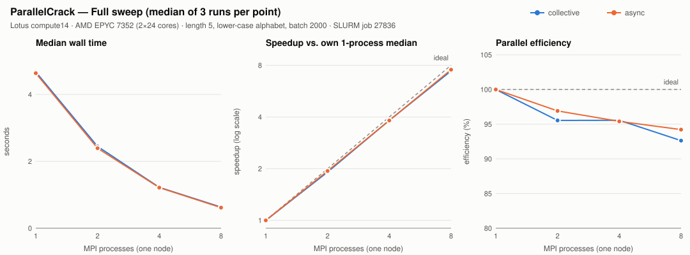
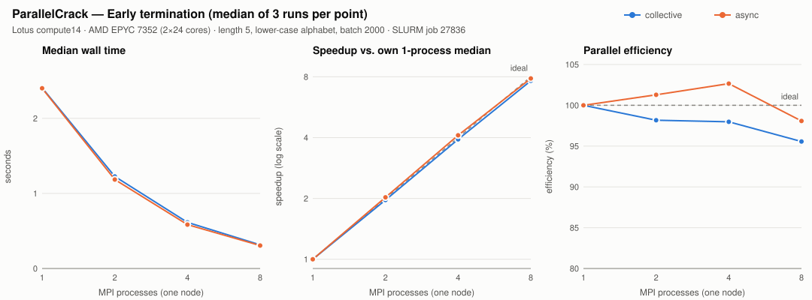

# Performance Methodology

This document defines *how* ParallelCrack is measured so that results are
reproducible and honest, and records what has actually been measured so far. The
first cluster results (a small single-node run on Lotus) are at the end; they are
preliminary and cover only 1–8 processes.

## What is measured

Each run records the following, written as one CSV row (see `results/README.md`):

| Metric                 | Definition                                                        |
|------------------------|-------------------------------------------------------------------|
| `wall_seconds`         | Wall-clock time of the search, measured on rank 0.                 |
| `candidates_evaluated` | Total candidates hashed across all ranks.                         |
| `hashes_per_second`    | `candidates_evaluated / wall_seconds`.                            |
| `comm_seconds`         | Max per-rank time spent inside MPI coordination (overhead).       |
| `rounds`               | Coordination rounds (collective) or batches by rank 0 (async).    |
| `found`, `finder_rank` | Outcome of the search.                                            |

From a sweep across process counts, `benchmarks/plot.py` derives:

* **Speedup** `S(p) = T(baseline) / T(p)`
* **Parallel efficiency** `E(p) = S(p) / (p / baseline_p)`

where the baseline is the smallest process count in the data (normally 1).

## How the timing is taken

* The search is bracketed by `MPI_Barrier` then `MPI_Wtime` at the start, and
  `MPI_Wtime` at the end, inside each strategy. The barrier ensures all ranks
  start the timed region together, so the wall time reflects the parallel search
  and not startup skew.
* **File decryption is never inside the timed region.** The file-recovery demo
  runs on rank 0 after the search completes, so encryption/decryption time does
  not pollute the search measurement.
* `comm_seconds` is accumulated by wrapping only the MPI coordination calls
  (`Allreduce` / `Iprobe` / `Test` / `Send` / `Wait` …) with `MPI_Wtime` and then
  taking the maximum across ranks. It therefore includes synchronization wait time,
  which is a real part of coordination cost.

## Two experiment types

The benchmark runs two distinct experiments, because "how fast does it scan
everything" and "how fast does it stop once it finds the answer" are different
questions:

* **Full-sweep (`--full-sweep`)** — the target is **unmatchable**, so every
  strategy scans the entire keyspace and evaluates *exactly* `keyspace` candidates
  with no early termination. This is the fixed, deterministic global workload used
  for strong scaling, and it guarantees both strategies do identical work. The
  candidate count is validated on every run.

  > This matters: an earlier version put a *findable* target at the last index.
  > With the asynchronous strategy, the rank that owns that index found it and
  > signalled the others to stop, so they abandoned their last few batches — a
  > timing-dependent undercount (e.g. 11,824,344 instead of 11,881,376 for length
  > 5). A valid fixed-work measurement must scan everything, so full-sweep now uses
  > an unmatchable target.

* **Early-termination (`--index K`)** — the target is a real candidate at a fixed
  index, identical for both strategies. The search finds it and ranks stop early.
  Here the asynchronous strategy evaluating fewer candidates than collective is the
  *measured effect*, not an error. This experiment measures how quickly each
  strategy terminates once the answer is found.

For either experiment, hold everything else constant across process counts: fix
`--length`, `--alphabet`, `--batch`, and `--poll`, use ≥ 3 repetitions, and let
`plot.py` average them.

## Execution modes on Lotus (SLURM)

* **Interactive allocation (`salloc`)** reserves nodes; you then run `srun` inside
  it. **Batch (`sbatch`)** queues a script to run on compute nodes later. In both,
  **`srun` inside the allocation** launches the MPI job across the reserved tasks.
  Running **`srun` without a valid allocation** would fall back to the login node —
  which must never be used for benchmarks; the provided scripts refuse to do so.
* ParallelCrack is launched with **`srun --mpi=pmix`** — the verified PMI. PMI2 was
  observed to start uncoordinated singleton processes.

## Process-count plan

* **Initial benchmark — single node only:** 1, 2, 4, 8, 16, 32, 48 processes,
  five repetitions each, run strictly sequentially via
  `benchmarks/lotus_benchmark.sbatch`.
* Larger, multi-node counts are intentionally out of scope for this stage. The
  professor's 35-node / 1680-task configuration is **not** used. Any future
  multi-node work (see the roadmap) is launched deliberately, never automatically.

## Expected effects to look for

These are *hypotheses to test*, not results:

* The collective strategy should show rising `comm_seconds` as `p` grows, because
  every batch pays for a full synchronization whose cost grows with `p`.
* The asynchronous strategy should show lower coordination overhead, but rank 0
  doing double duty (coordinator + worker) may limit its own search throughput.
* Early-termination latency (how quickly all ranks stop after the first match)
  should favor the asynchronous strategy at large `p`, since it does not wait for a
  global collective to propagate the result.

## Threats to validity

* **Oversubscription:** running more MPI processes than physical cores (as the
  local test launcher does) distorts timings. Treat laptop numbers as smoke tests;
  take real measurements on dedicated cluster cores.
* **Warm-up and caching:** the first run of a configuration can be slower. Keep
  `--repeats` ≥ 3 and consider discarding the first.
* **Hash cost dominates:** the per-candidate SHA-256 is cheap and uniform, so this
  benchmark stresses *coordination*, not computation. That is intentional, but it
  means conclusions are about communication strategy, not raw crypto throughput.

---

## Experimental results (preliminary)

### Run 1 — Lotus, SLURM job 27836 (2026-11-12)

This was a deliberately small first run (`benchmarks/lotus_quick.sbatch`) to check
the pipeline end to end on real cluster hardware before the larger 1–48 process
benchmark. Raw data, metadata, run log, and checksums are in
[`results/lotus/job27836/`](../results/lotus/job27836/).

**Setup.** One node (`compute14`, AMD EPYC 7352, 2 sockets × 24 cores), 8 tasks
allocated, launched with `srun --mpi=pmix`. GCC 13.3.0, SLURM 25.11.4, OpenSSL
3.2.1, code at `36f4cdb`. Workload: length 5, lower-case alphabet (keyspace
11,881,376), batch 2000, poll 1. Process counts 1, 2, 4, 8; 3 repetitions each;
both strategies; both experiment types — 48 launches, all exited 0 and passed the
in-job correctness checks.

**Analysis.** `benchmarks/analyze_results.py` re-validates the CSVs independently
of the job script (exact candidate count and no match on every full-sweep row;
correct index and owning rank on every early-termination row; hash rate equal to
candidates / wall time), then reports the **median** of the 3 runs. Speedup is
`median T(1) / median T(p)` against the same strategy's own 1-process run, and
efficiency is `speedup / p`. Variability is shown as the min–max range and the
coefficient of variation (sample stdev / mean). With only 3 runs per point, CV is
a rough indicator, not a confidence interval.

#### Full sweep (fixed work: every run evaluates all 11,881,376 candidates)

| Strategy | p | Median wall (s) | Min–max (s) | CV | Speedup | Efficiency | Median comm (s) |
|---|---:|---:|---:|---:|---:|---:|---:|
| collective | 1 | 4.675 | 4.661–4.802 | 1.7% | 1.00× | 100.0% | 0.0006 |
| collective | 2 | 2.447 | 2.425–2.461 | 0.7% | 1.91× | 95.5% | 0.0515 |
| collective | 4 | 1.223 | 1.215–1.263 | 2.1% | 3.82× | 95.6% | 0.0515 |
| collective | 8 | 0.631 | 0.629–0.633 | 0.4% | 7.41× | 92.6% | 0.0499 |
| async | 1 | 4.638 | 4.588–4.776 | 2.1% | 1.00× | 100.0% | 0.0000 |
| async | 2 | 2.393 | 2.377–2.436 | 1.3% | 1.94× | 96.9% | 0.0098 |
| async | 4 | 1.215 | 1.213–1.228 | 0.6% | 3.82× | 95.4% | 0.0559 |
| async | 8 | 0.615 | 0.606–0.623 | 1.3% | 7.54× | 94.2% | 0.0369 |

#### Early termination (target at index 5,940,688, the middle of the keyspace)

| Strategy | p | Median wall (s) | Min–max (s) | CV | Speedup | Efficiency | Median comm (s) |
|---|---:|---:|---:|---:|---:|---:|---:|
| collective | 1 | 2.407 | 2.400–2.422 | 0.5% | 1.00× | 100.0% | 0.0003 |
| collective | 2 | 1.226 | 1.206–1.247 | 1.7% | 1.96× | 98.2% | 0.0244 |
| collective | 4 | 0.614 | 0.609–0.617 | 0.7% | 3.92× | 98.0% | 0.0320 |
| collective | 8 | 0.315 | 0.309–0.316 | 1.2% | 7.64× | 95.6% | 0.0221 |
| async | 1 | 2.401 | 2.366–2.517 | 3.2% | 1.00× | 100.0% | 0.0000 |
| async | 2 | 1.185 | 1.172–1.238 | 2.9% | 2.03× | 101.3% | 0.0009 |
| async | 4 | 0.585 | 0.583–0.613 | 2.9% | 4.11× | 102.7% | 0.0008 |
| async | 8 | 0.306 | 0.296–0.308 | 2.1% | 7.85× | 98.1% | 0.0007 |

Candidates evaluated in the early-termination runs (the sequential minimum is
5,940,689, i.e. the target index + 1):

| p | collective (all 3 runs) | async (min–max over 3 runs) |
|---:|---:|---:|
| 1 | 5,940,689 | 5,940,689 |
| 2 | 5,942,345 | 5,848,345 – 6,034,345 |
| 4 | 5,943,173 | 5,827,173 – 6,033,173 |
| 8 | 5,950,587 | 5,868,587 – 6,086,587 |

### Observations

1. **Near-linear single-node strong scaling up to 8 processes.** On the fixed
   full-sweep workload, median wall time dropped from about 4.7 s to about 0.62 s:
   7.41× (92.6% efficiency) for collective and 7.54× (94.2%) for async at p = 8.
   Run-to-run variation was small (CV ≤ 2.1% for every configuration).
2. **The two strategies cost the same at p = 1.** 4.675 s vs. 4.638 s, well inside
   the run-to-run range of each. This is a useful sanity check that the shared
   search loop, not the strategy code, dominates single-process cost.
3. **Async was slightly faster at p = 8, but the margin is small.** In the full
   sweep the async median was about 2.5% lower (0.615 s vs. 0.631 s) and the
   min–max ranges did not overlap; at p = 2 and 4 the ranges overlap and the
   strategies are indistinguishable. Three runs on one node are not enough to call
   this a general result.
4. **Efficiency falls off slowly with p** (full sweep, collective: 95.5% → 95.6% →
   92.6%). The measured `comm_seconds` for collective was roughly flat at about
   0.05 s from p = 2 to p = 8, which is about 8% of the p = 8 wall time. The
   expected *growth* of collective overhead with p was not visible in this small
   range; it needs the larger process counts to test.
5. **Collective stops deterministically; async does not.** Collective evaluated
   the same number of candidates in every repetition, overshooting the minimum by
   1,656 / 2,484 / 9,898 candidates at p = 2 / 4 / 8 (less than one batch per rank,
   since every rank finishes its current batch before the `MPI_Allreduce`). Async
   varied by up to about ±2% between repetitions and sometimes evaluated *fewer*
   candidates than the sequential run, because some workers had not yet reached
   the target's position in the keyspace when the stop message arrived.
6. **The >100% async efficiencies in early termination are not real superlinear
   speedup.** They come from (5): those runs did less work than the 1-process
   baseline, combined with only 3 repetitions. The full-sweep numbers, where work
   is fixed, are the ones to use for scaling claims.
7. **Measured coordination time in early termination was much lower for async**
   (≈0.0007 s vs. ≈0.022 s median at p = 8), but the wall-time difference was
   only about 3% (0.306 s vs. 0.315 s). The two strategies instrument different
   MPI calls, so `comm_seconds` is better read as a per-strategy diagnostic than as
   a head-to-head comparison.
8. **Early termination took about half the full-sweep time** for every
   configuration, as expected with the target in the middle of the keyspace and
   cyclic distribution (every rank advances through the keyspace at roughly the
   same rate).

### Limitations

* **Single node, at most 8 processes.** Only 8 of the node's 48 cores were used.
  Nothing here says anything about behaviour at 16–48 processes, across the two
  sockets under full load, or across nodes. No multi-node runs have been done.
* **Small sample.** 3 repetitions per point, all from one job on one node at one
  time. Runs are short (0.3–4.8 s), so fixed startup costs and timer noise matter
  more than they would on longer runs.
* **One workload configuration.** Length 5, batch 2000, poll 1 only. Batch size
  and polling interval directly affect coordination cost and were not varied.
* **Target always owned by rank 0.** The early-termination index (5,940,688) is
  divisible by 1, 2, 4, and 8, so under cyclic distribution rank 0 found it in
  every run. For async, rank 0 is also the coordinator, so the path where a
  *worker* reports the match to rank 0 was not exercised in this benchmark.
* **Process placement not recorded.** CPU binding and socket placement were left
  to SLURM defaults and are not in the metadata.
* **`comm_seconds` includes waiting.** It wraps the MPI calls, so it includes
  synchronization and load-imbalance wait, not just message cost, and the two
  strategies wrap different calls.
* **Baseline is the 1-rank MPI program**, not a separate serial implementation.

### Next steps

* Run the full single-node benchmark (`benchmarks/lotus_benchmark.sbatch`, 1–48
  processes, 5 repetitions) to see where efficiency actually starts to drop and
  whether the collective overhead grows with p.
* Use a larger keyspace (e.g. length 6) so runs last long enough for timing noise
  to matter less.
* Choose early-termination indices owned by different ranks (including non-zero
  ranks) so the async worker-to-coordinator path is measured.
* Sweep `--batch` and `--poll` to measure the trade-off between coordination
  frequency and overshoot.
* Record CPU binding (`--cpu-bind`) and socket placement in the metadata, and
  split `comm_seconds` into wait time and message time.
* Multi-node runs only after the single-node picture is clear (see the roadmap).
